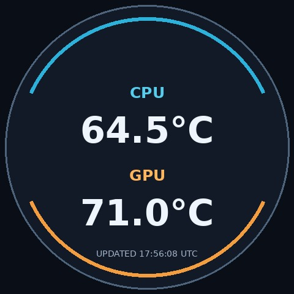

# OMEN LCD Linux

Native Linux CPU/GPU dashboard for the physical HP OMEN MAX 45L GT23 cooler LCD. It targets HP USB `03f0:7397`, interface 1. Live temperature updates have been confirmed on one GT23 system, with a nonroot service refreshing every two seconds. This is an experimental implementation, with other hardware and firmware variants unverified.



The image above uses sample readings. The application reads AMD CPU temperatures through `k10temp` and NVIDIA GPU temperatures through `nvidia-smi`. Missing readings appear as `--`; each frame includes its update time in UTC.

## Quick start

Create a fresh user environment and install the project:

```sh
python3 -m venv .venv
.venv/bin/python -m pip install .
.venv/bin/omen-lcd list
.venv/bin/omen-lcd preview /tmp/omen-preview.jpg
```

`list` discovers the exact interface without opening it. `preview` reads CPU/GPU sensors and writes a host JPEG without USB access. `show FILE` sends one frame and `run --interval 2` refreshes live temperatures.

`show` and `run` require permission for the exact udev node. The service uses `/opt/omen-lcd-linux/venv/bin/omen-lcd`, runs as the selected nonroot user, and receives the optional `omenlcd` supplementary group. It does not change default user group memberships.

The service is intentionally not enabled by default. Install it without starting it:

```sh
sudo scripts/install-service.sh --user YOURUSER --no-start
```

If the LCD was already connected when the udev rule was installed, run `list`, choose the reported exact `/dev/hidrawN`, and trigger only that node:

```sh
sudo udevadm trigger --action=change /sys/class/hidraw/hidrawN
```

Then enable the service for the current session and future boots:

```sh
sudo systemctl enable --now omen-lcd.service
systemctl status omen-lcd.service
```

The service receives `omenlcd` through `SupplementaryGroups`; an ordinary shell does not automatically gain that group. Use the service or an explicitly authorized one-time privileged test until the user’s group setup is changed deliberately. Uninstall removes only the service unit, installed udev rule, and `/opt/omen-lcd-linux` copy; it leaves the checkout, user accounts/groups, and caches untouched.

Physical output remains an experimental single-hardware-ID integration. No HP endorsement is implied.

## Development and scope

Run `python -m pip install pytest` in the environment, then `python -m pytest -q`. The tests use simulated devices and do not access USB. See [the protocol observations](docs/protocol-analysis.md) and [validation status](docs/VALIDATION.md).

Only the observed live-image synchronization operation is implemented. There are no firmware-update, fan, pump, RGB, or stored-image download commands. A successful USB write has no application-level acknowledgement. On a normal service stop, the client attempts to replace the retained readings with an unavailable-data frame; after a connection failure, the last frame may remain, so check its timestamp. The device's behavior across power loss and the persistence of received images have not been established.

Original project code is available under the [MIT license](LICENSE). HP software and assets are not included; see [third-party notices](THIRD_PARTY.md).
